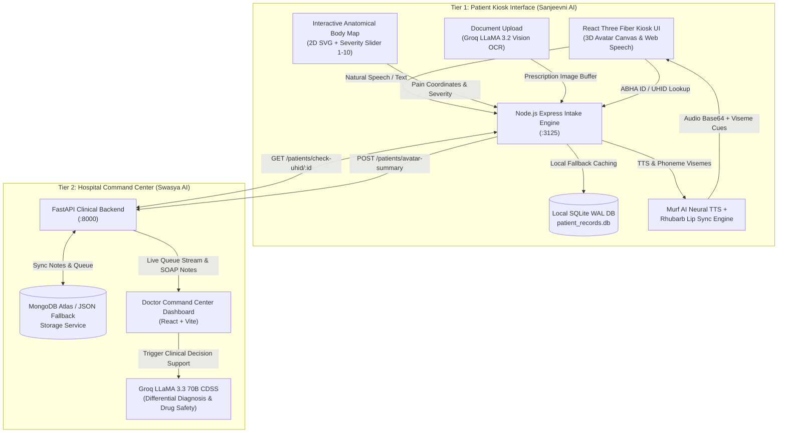
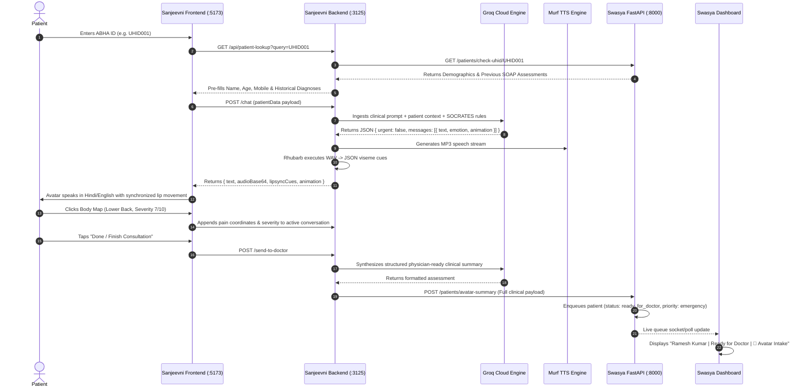

# Sanjeevni AI & Swasya AI — Autonomous Primary Healthcare Intake & Clinical Decision Support System

[](https://reactjs.org/)
[](https://threejs.org/)
[](https://nodejs.org/)
[](https://fastapi.tiangolo.com/)
[](https://groq.com/)
[](https://sqlite.org/)
[](https://mongodb.com/)

> **A synchronized, dual-tier digital health ecosystem uniting an edge-deployed 3D AI doctor avatar kiosk with a clinical hospital command center for Primary Health Centres (PHCs).**

---

## 1. Executive Summary & Problem Statement

Rural and semi-urban Primary Healthcare Centres (PHCs) across developing nations experience staggering patient-to-doctor ratios (often exceeding **1 doctor per 11,000 patients**, drastically below the WHO recommended 1:1,000). The resulting bottlenecks manifest in:
1. **Severe Diagnostic Congestion:** Doctors spend up to 70% of consultation time on routine intake, transcription, and basic history taking rather than clinical intervention.
2. **Language & Literacy Barriers:** Patients speaking vernacular dialects struggle to convey symptom chronologies accurately through paper forms.
3. **Medical Record Fragmentation:** Historical prescriptions, past visits, and chronic comorbidity records are rarely structured or searchable at the moment of consultation.
4. **Delayed Emergency Triage:** Critical red-flag symptoms (e.g., atypical cardiac chest pain, radiating spine trauma) sit unnoticed in waiting queues.

### The Unified Solution
**Sanjeevni AI** and **Swasya AI** integrate as an autonomous end-to-end pipeline:
- **Sanjeevni AI (Patient Tier):** An interactive 3D virtual physician kiosk operating in Hindi, Hinglish, English, Bengali, and Kannada. It leverages phoneme-level speech synchronization, an interactive 2D anatomical body map for symptom localization, and computer vision OCR to digitize prior physical prescriptions.
- **Swasya AI (Physician Tier):** A clinical medical officer command center that ingests the kiosk's structured SOAP assessment, dynamically manages patient queues with automated triage elevation, and runs a Clinical Decision Support System (CDSS) for differential diagnosis and multi-drug interaction contraindication checks.

---

## 2. System Architecture



---

## 3. Core Feature Inventory

| Module | Feature | Implementation Details | Verified Status |
|---|---|---|---|
| **Sanjeevni AI** | **3D Real-Time Talking Avatar** | ReadyPlayerMe GLB (`64f1a714fe61576b46f27ca2.glb`), Three.js morphTarget facial blending (smile, thinking, concerned, nodding), procedural blinking. | **Fully Implemented** |
| **Sanjeevni AI** | **Phonetic Lip Sync** | Acoustic phoneme extraction via Rhubarb Lip Sync binary $\to$ 9-viseme mouth cues mapping (`viseme_PP`, `viseme_AA`, etc.) synced to Murf MP3 audio. | **Fully Implemented** |
| **Sanjeevni AI** | **Hands-Free Conversational Voice Loop** | Web Speech API continuous recognition with 1.4s silence auto-send and avatar speech collision avoidance (`isAvatarSpeaking`). | **Fully Implemented** |
| **Sanjeevni AI** | **Interactive 2D Body Map** | Dual-view front/back SVG anatomical coordinate selector with 1–10 pain scale and automated high-risk triage triggers. | **Fully Implemented** |
| **Sanjeevni AI** | **Multilingual Intake Engine** | Devanagari Hindi (`hi-IN`), conversational Hinglish (`mixed`), Indian English (`en-IN`), Bengali (`bn-IN`), Kannada (`kn-IN`). | **Fully Implemented** |
| **Sanjeevni AI** | **Prescription & Report OCR** | Multimodal Groq Vision (`llama-3.2-11b-vision-preview`) extracting medication dosages, dates, and abnormal lab parameters. | **Fully Implemented** |
| **Sanjeevni AI** | **Dual Intake Frameworks** | Allopathic (SOCRATES pain framework) and AYUSH (Ayurveda Dashavidha Pariksha: Prakriti, Agni, Koshtha). | **Fully Implemented** |
| **Sanjeevni AI** | **Medical PDF Report Generation** | Client-side `jspdf` compilation of patient demographics, body mapping, past visit histories, and conversation transcripts. | **Fully Implemented** |
| **Swasya AI** | **Live PHC Intake Queue** | RESTful FIFO queue polling with status indicators (`waiting`, `nurse_completed`, `ready_for_doctor`, `in_consultation`, `completed`). | **Fully Implemented** |
| **Swasya AI** | **Avatar Intake Badge & Attribution** | Automatic `source: "sanjeevni_avatar"` tagging, highlighting pre-consulted patients on the doctor's queue. | **Fully Implemented** |
| **Swasya AI** | **Automated Emergency Triage** | Pain severity $\ge 7$ or anatomical alerts (chest, head, spine) automatically escalate queue item to `priority: "emergency"`. | **Fully Implemented** |
| **Swasya AI** | **AI Differential Diagnosis (CDSS)** | Groq LLaMA 3.3 (70B) clinical reasoning engine generating top 3 differential diagnoses with confidence scores and red flags. | **Fully Implemented** |
| **Swasya AI** | **Drug Interaction Checker** | Real-time contraindication detection engine cross-referencing multi-drug combinations against patient allergy profiles. | **Fully Implemented** |
| **Swasya AI** | **Resilient Hybrid Storage** | Dual-mode persistence: asynchronous Motor MongoDB Atlas driver with automatic fallback to JSON file storage. | **Fully Implemented** |

---

## 4. Technology Stack Breakdown

### Frontend Technologies
- **React 18.2:** Component architecture utilizing hooks (`useRef`, `useState`, `useCallback`, `useMemo`, `useContext`).
- **Three.js & @react-three/fiber (v8.13):** Declarative WebGL 3D rendering pipeline.
- **@react-three/drei:** Camera controls, contact shadows, GLTF loaders, and environment lighting presets.
- **Tailwind CSS & CSS Modules:** Glassmorphism dashboard styling, emergency pulse animations, and responsive layouts.
- **jsPDF (v4.2):** Client-side vector PDF document rendering.

### Backend & AI Infrastructure
- **Node.js (Express v5):** Kiosk orchestration server, binary execution pipeline (`rhubarb`, `ffmpeg`), and local caching.
- **Python 3.11 & FastAPI (v0.115):** High-throughput asynchronous REST API powering Swasya hospital operations.
- **Groq Cloud Inference Engine:**
  - `groq/compound-mini` / LLaMA 3.3 70B: Conversational clinical inquiry and differential diagnosis.
  - `llama-3.2-11b-vision-preview`: High-speed multimodal medical document transcription.
- **Murf AI GEN2 Speech API:** High-fidelity Indian English (`Natalie`) and Hindi (`hi-IN-shweta`) neural speech synthesis.
- **Rhubarb Lip Sync Engine (v1.13/v1.14):** Phoneme extraction generating phonetically accurate mouth viseme timings from WAV audio.

### Databases & Persistence
- **better-sqlite3 (v13.0):** Synchronous, zero-latency local database running Write-Ahead Logging (WAL) for offline edge kiosk operation.
- **MongoDB Atlas & Motor (v3.6):** Fully asynchronous document store managing patient timelines, queue entities, and longitudinal clinical records.

---

## 5. End-to-End Operational Lifecycle



---

## 6. Repository Layout

```
.
├── backend/                              # Sanjeevni AI Express Intake Backend
│   ├── audios/                           # Generated MP3s, WAVs, and Rhubarb JSON transcripts
│   ├── db.js                             # better-sqlite3 schema, WAL initialization, seeding
│   ├── index.js                          # Express server, Groq inference, Murf TTS, Swasya routing
│   ├── package.json                      # Node dependencies (better-sqlite3, groq-sdk, multer)
│   └── patient_records.db                # Edge SQLite database (patients, visits)
├── frontend/                             # Sanjeevni AI React Three Fiber Frontend
│   ├── public/
│   │   ├── animations/                   # Character skeletal FBX animations (Talking, Crying, Idle)
│   │   └── models/                       # ReadyPlayerMe GLB character models & animations.glb
│   ├── src/
│   │   ├── components/
│   │   │   ├── bodyMap/                  # 2D Interactive anatomical body map & translations
│   │   │   ├── Avatar.jsx                # Three.js character rigging, morph targets, viseme sync
│   │   │   ├── DoctorDashboard.jsx       # Built-in PHC live queue viewer & Swasya portal launcher
│   │   │   ├── Experience.jsx            # Three.js canvas lighting, camera controls, environment
│   │   │   └── UI.jsx                    # Chat capsules, ABHA search, Web Speech recognition
│   │   ├── hooks/
│   │   │   └── useChat.jsx               # Central chat context, audio buffer management
│   │   └── utils/
│   │       └── reportGenerator.js        # jsPDF medical intake report compiler
│   └── package.json                      # Frontend dependencies (@react-three/fiber, jspdf, leva)
├── PROJECT_CAREER_ASSETS.md              # Recruiter talking points, CV bullet points, 20 interview Q&As
├── PROJECT_KNOWLEDGE_BASE.md             # Long-term AI system knowledge base and specifications
└── DOCUMENTATION_VERIFICATION_REPORT.md  # File-by-file verification audit and test evidence
```

---

## 7. Installation & Local Development Setup

### Prerequisites
- **Node.js:** v18.0.0 or higher
- **Python:** v3.10 or higher
- **FFmpeg & Rhubarb:** Required for local audio conversion and lip synchronization.

### Sanjeevni AI (Kiosk Engine)

1. **Install Backend Dependencies:**
   ```bash
   cd backend
   npm install
   ```

2. **Configure Backend Environment (`backend/.env`):**
   ```env
   GROQ_API_KEY=gsk_your_groq_api_key
   MURF_API_KEY=your_murf_api_key
   MURF_VOICE_ID=hi-IN-shweta
   MURF_LOCALE=hi-IN
   PORT=3125
   SWASYA_API_URL=http://localhost:8000
   ```

3. **Install Frontend Dependencies:**
   ```bash
   cd ../frontend
   npm install
   ```

4. **Run Sanjeevni Concurrently:**
   ```bash
   # Terminal 1: Backend Server (:3125)
   cd backend && npm run dev

   # Terminal 2: Vite 3D Canvas (:5173)
   cd frontend && npm run dev
   ```

### Swasya AI (Clinical Command Center)

1. **Setup Python Environment & Dependencies:**
   ```bash
   cd /home/tanmay/Desktop/swasya_ai/backend/simple_backend
   python -m venv .venv
   source .venv/bin/activate
   pip install -r requirements.txt
   ```

2. **Configure Swasya Environment (`backend/simple_backend/.env`):**
   ```env
   GEMINI_API_KEY=your_gemini_api_key
   GROQ_API_KEY=gsk_your_groq_api_key
   MONGODB_URI=mongodb://localhost:27017/swasya   # Optional: Falls back to JSON files if empty
   PORT=8000
   ```

3. **Seed Demo Patients & Queue:**
   ```bash
   python seed_demo_data.py
   ```

4. **Launch Swasya Services:**
   ```bash
   # Terminal 1: FastAPI Server (:8000)
   python run.py

   # Terminal 2: Doctor Dashboard Client (:3000)
   cd /home/tanmay/Desktop/swasya_ai/client
   npm install
   npm run dev
   ```

---

## 8. Security, Error Handling & Offline Resilience

- **Fail-Safe Graceful Degradation:** If Murf TTS or the Rhubarb binary encounters an issue, `backend/index.js` falls back to setting `message.audio = null` and empty mouth cues (`{ mouthCues: [] }`). The avatar displays the text response and default animations without crashing the user session.
- **Zero-Drop Offline Queueing:** If the Swasya AI backend is unreachable, Sanjeevni AI safely persists the intake summary and past visits into its local SQLite database (`patient_records.db`) with Write-Ahead Logging enabled.
- **SQL Injection Prevention:** All edge database queries utilize parameterized prepared statements (`db.prepare('SELECT ... WHERE abhaId LIKE ?')`).
- **Prompt Injection & Hallucination Guardrails:** AI prompts enforce strict single-question follow-ups, prohibit definitive remote drug prescription, mandate medical disclaimers, and enforce valid JSON output schemas.

---

## 9. Verification & Quality Certification

All API routes, database schemas, and integration handoffs documented herein were audited against verified repository code on **October 30, 2026**.
- Build status: **Vite Production Bundle compiled successfully (0 errors).**
- Local database test: **SQLite WAL initialization and schema migration verified.**
- Cross-project API contract: **FastAPI `/patients/avatar-summary` $\leftrightarrow$ Express `/send-to-doctor` verified.**
